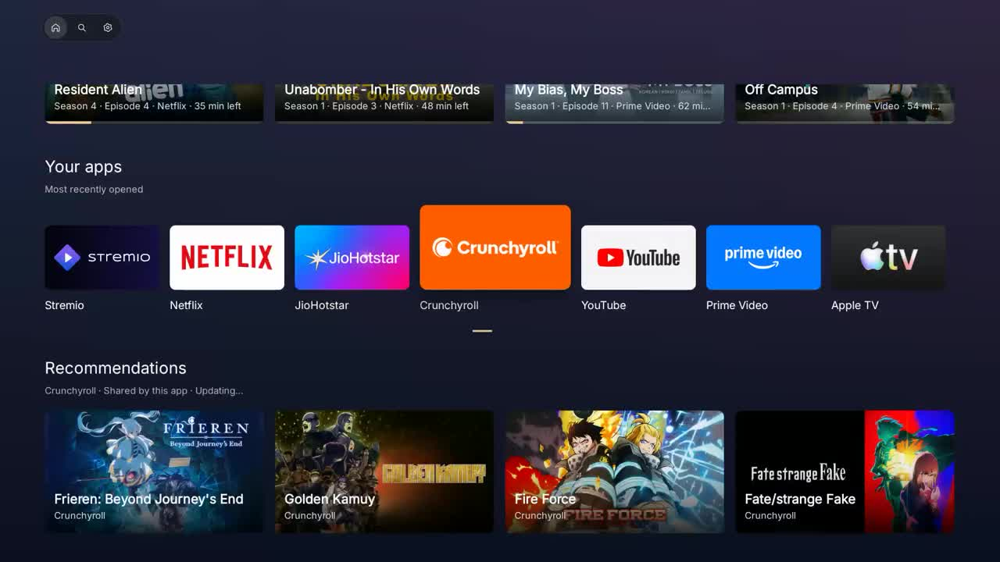

# fudge-tv

A native Android TV launcher with Continue Watching, your installed apps, shared recommendations, and Cinemeta discovery and search.

[](docs/intro.mp4)

[Watch the 21-second intro](docs/intro.mp4) · Recorded on a real TV, without audio.

## Build

Requires Java 21, Python 3, Android SDK 35, and build-tools 35.0.0. Android 12 or newer is required on the TV.

```sh
./verify.sh
```

Produces `fudge-launcher.apk` and runs formatting, unit tests, lint, and APK signature verification.

## Install

Connect ADB, then supply the exact target details:

```sh
./build-and-install.sh --serial "$TV_SERIAL" --model "$TV_MODEL" --sdk "$TV_API" --user "$TV_USER"
```

Preview the app before choosing it as Home. Keep the original Home available, and restore and verify it before uninstalling this launcher. The installer does not change Home, permissions, or system settings.

## More

- [Development, architecture, and verification](docs/development.md)
- [Device recovery](docs/device-recovery.md)
- [Recommendation boundaries](docs/recommendations.md) · [Catalog contracts](docs/cinemeta-migration.md)
- [Third-party notices](THIRD_PARTY_NOTICES.md)

No project-wide license has been selected.
